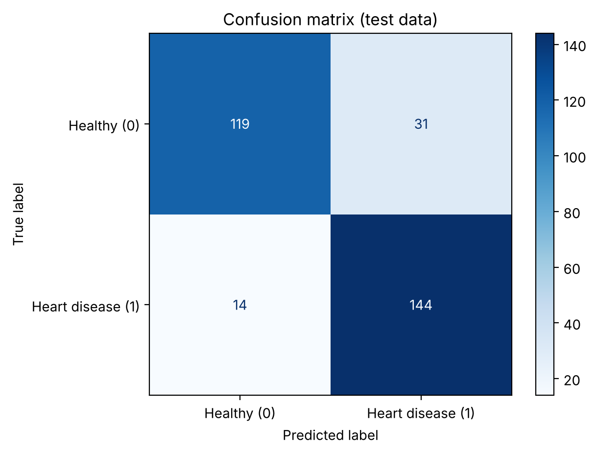

# Heart Disease Prediction using Logistic Regression

A machine learning project that predicts whether a patient has heart disease from 13 clinical measurements, built in Python with scikit-learn.

## 📌 Problem
Heart disease is one of the leading causes of death worldwide, and early detection helps doctors act sooner. The goal of this project is to classify patients as **having heart disease (1)** or **healthy (0)** from routine clinical data such as age, chest pain type, cholesterol and maximum heart rate.

## 📂 Dataset
- **Source:** [Heart Disease Dataset – Kaggle](https://www.kaggle.com/datasets/johnsmith88/heart-disease-dataset) (based on the UCI Cleveland, Hungary, Switzerland and Long Beach V heart disease databases)
- **Size:** 1,025 patient records, 13 features + 1 target column
- **Quality:** no missing values, balanced classes (526 with heart disease, 499 healthy)

| Feature | Meaning |
|---|---|
| age | Age in years |
| sex | 1 = male, 0 = female |
| cp | Chest pain type (0–3) |
| trestbps | Resting blood pressure (mm Hg) |
| chol | Serum cholesterol (mg/dl) |
| fbs | Fasting blood sugar > 120 mg/dl |
| restecg | Resting ECG results |
| thalach | Maximum heart rate achieved |
| exang | Exercise-induced angina |
| oldpeak | ST depression induced by exercise |
| slope | Slope of the peak exercise ST segment |
| ca | Number of major vessels (0–4) |
| thal | Thalassemia type |
| **target** | **1 = heart disease, 0 = healthy** |

## 🛠️ Approach
1. **Data checks:** shape, data types, missing values, summary statistics
2. **Exploration:** target class balance and max heart rate vs. heart disease
3. **Train/test split:** 70% training (717 rows) / 30% testing (308 rows), stratified to keep the class ratio
4. **Model:** feature scaling (`StandardScaler`) + logistic regression in one scikit-learn pipeline
5. **Evaluation:** accuracy, confusion matrix, precision, recall and F1-score
6. **Predictive system:** predicts heart disease for a single new patient's input
7. **Feature comparison:** retrained the model on three smaller 5-feature sets to see whether fewer features work as well

## 📊 Results

| Metric | Score |
|---|---|
| Training accuracy | 84.10% |
| **Test accuracy** | **85.39%** |
| Recall (heart disease class) | 0.91 |
| Precision (heart disease class) | 0.82 |
| F1-score (weighted) | 0.85 |

The model correctly identified **144 of 158** patients with heart disease in the test set. High recall matters most here, because missing a real case is more costly than a false alarm.

**Fewer features vs. all features (test accuracy):**

| Feature set | Test accuracy |
|---|---|
| **All 13 features** | **85.39%** |
| age, cp, trestbps, chol, fbs | 73.38% |
| restecg, thalach, oldpeak, trestbps, chol | 75.97% |
| sex, restecg, ca, thalach, trestbps | 79.22% |

Using all 13 features performs best.

## ⚠️ Limitations and next steps
- The Kaggle file contains many repeated rows (only 302 of the 1,025 rows are unique), so the same patient can appear in both the training and test data. The accuracy may therefore be optimistic.
- Next steps: remove duplicates, use cross-validation, and compare with other models such as random forest and k-nearest neighbours.

## 🧰 Tools
Python · pandas · NumPy · Matplotlib · scikit-learn · Google Colab / Jupyter

## ▶️ How to run
1. Download `heart.csv` from this repository (or from the Kaggle link above).
2. Open `Heart_Disease_Prediction.ipynb` in Google Colab or Jupyter.
   - In Colab, upload `heart.csv` and change the path in the first code cell to `/content/heart.csv`.
3. Install the requirements if running locally: `pip install -r requirements.txt`
4. Run all cells.

## 📁 Files
| File | Description |
|---|---|
| `Heart_Disease_Prediction.ipynb` | Full notebook with code, charts and results |
| `heart.csv` | Dataset (1,025 rows) |
| `confusion_matrix.png` | Confusion matrix chart used in this README |
| `requirements.txt` | Python libraries needed to run the notebook |

---
👩‍💻 **Manasi Kole** · [GitHub](https://github.com/Manasi-kole) · [Data Analytics Portfolio](https://github.com/Manasi-kole/Manasi-s_Data_Analytics_Portfolio)
